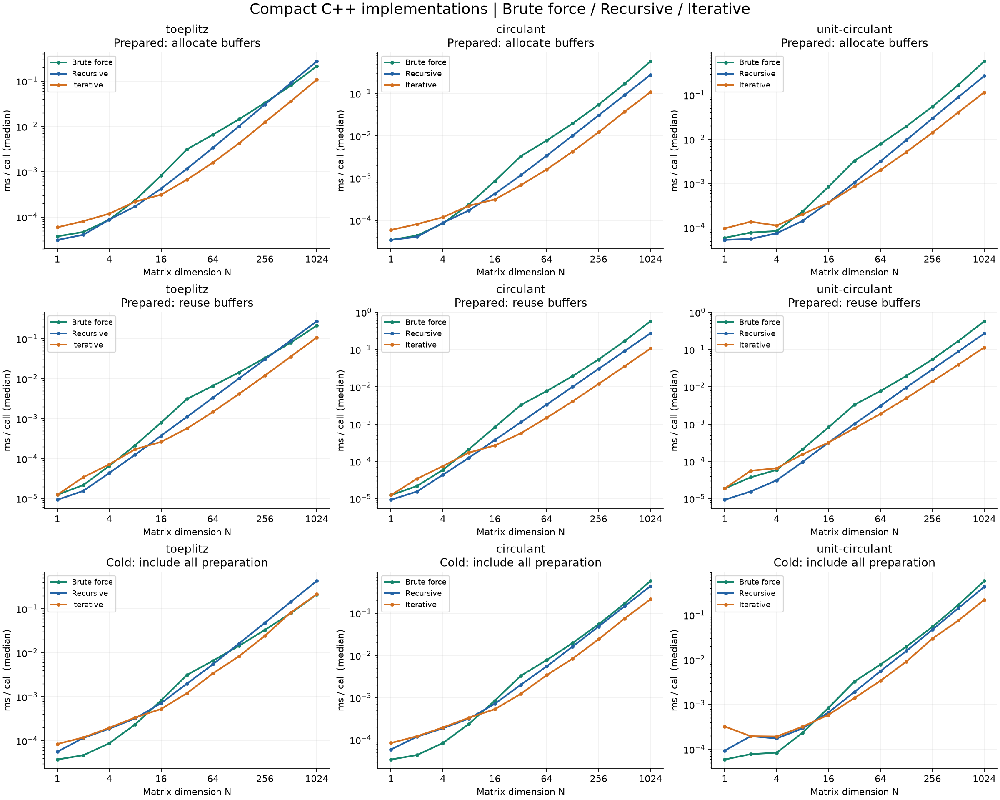

# Dynamic Matrix Multiplication

**A reconstruction of Dynamic Multiplication for power-of-two Toeplitz and circulant matrix–vector products over GF(2⁸), in Python and C++17.**

[繁體中文導覽](docs/README.zh-TW.md) · [Derivation and cost model](docs/algorithm.md) · [Reconstruction notes](docs/reconstruction.md)

[](https://github.com/bagpiper1458/dynamic-matrix-multiplication/actions/workflows/test.yml)

Start with the [latest three-way comparison](analysis/packed/README.md), [C++ implementations and reproduction commands](docs/packed.md), and [paper-to-code correspondence](docs/paper-correspondence.zh-TW.md).

This project implements the algorithm in the author-provided manuscript *Improve Computing Efficiency of 2ⁿ × 2ⁿ Toeplitz Matrix and Circulant Matrix Multiplication over Galois Fields by Dynamic Multiplication*, by Yang-Bi Jiang, Yan-Wen Chen, Luo-You Jian, and Li-Der Chou. The author subsequently recovered formula-generation/validation code and clarified that PARAMS reuse had only been described in pseudocode. The reusable recursive and iterative implementations here are new work based on those sources, with fresh tests and benchmarks. No publication venue or reproduction of the original experimental environment is asserted here.

## What it does

- Computes **matrix–vector** products for N = 2ⁿ, including N = 1.
- Implements the three-child recursive decomposition and a nonrecursive PARAMS schedule for Toeplitz and circulant matrices.
- Supports the unit-row-sum circulant shortcut, with the row sum checked using **XOR**.
- Separates matrix preparation from repeated vector evaluation.
- Counts executed field operations and compares against a conventional O(N²) baseline.
- Includes independent scalar arithmetic checks, shared Python/C++ fixtures, input validation, and reproducible benchmarks.

All elements are bytes representing polynomials modulo **0x11B**, or x⁸ + x⁴ + x³ + x + 1, matching the manuscript's scalar code. Circulant input is the **first column**: `C[i,j] = column[(i-j) % N]`.

| Method | Field multiplications per vector | Field additions per vector |
|---|---:|---:|
| Conventional | N² | N(N−1) |
| Dynamic | 3ⁿ | 3(3ⁿ−2ⁿ) |
| Dynamic, unit-row-sum circulant | 3ⁿ−2ⁿ | 3(3ⁿ−2ⁿ) |

The dynamic addition counts exclude coefficient preparation. The recursive reference and both new compact C++ preparation methods perform **3·3ⁿ − 4·2ⁿ + 1 coefficient XORs**, plus input checks. The reference iterative implementation shares repeated symbolic coefficient sums through a dimension-only layout (4×4: 11 XORs for Toeplitz, 5 for circulant). The new compact implementation trades that coefficient deduplication for direct numeric preparation without a hash layout. These costs and allocation overhead matter for a single product. Fewer field operations do not guarantee a lower runtime. See [the full cost model](docs/algorithm.md) and [the compact implementation tradeoffs](docs/packed.md).

## Python: no third-party runtime dependencies

Requires Python 3.10 or later. Run from the repository root:

```sh
python -m dynamic_matrix demo
python -m unittest discover -s tests -v
python tools/generate_fixtures.py --check
python -m dynamic_matrix counts --max-exponent 7
```

```python
from dynamic_matrix import Counts, prepare_circulant, prepare_toeplitz

plan = prepare_circulant([2, 1, 1, 3], unit_row_sum=True)
counts = Counts()
result = plan.matvec([0xDB, 0x13, 0x53, 0x45], counts=counts)
assert result == (0x8E, 0x4D, 0xA1, 0xBC)
assert (counts.multiplications, counts.additions) == (5, 15)

# Reuse a plan with a new vector; it owns its prepared coefficients.
assert plan.matvec([1, 0, 0, 0]) == (2, 1, 1, 3)

# T = [[5, 9], [7, 5]]
toeplitz = prepare_toeplitz(first_column=[5, 7], first_row=[5, 9])
print(toeplitz.matvec([11, 13]))
```

`Counts` accumulates when reused. Start a new instance for each measured product. Plans are immutable; input lists are not modified. Inputs must be integer bytes (Python rejects booleans, floats, negatives, and values above 255).

## C++17

The improved implementations are in `cpp/packed_matrix.hpp`, with the shared field kernel in `cpp/dynamic_matrix.hpp`. The original recursive and iterative implementations remain available as references. The C++ API uses `std::vector<std::uint8_t>`; callers must validate wider numeric input before conversion to bytes. See [the compact API](docs/packed.md) for recursive/iterative preparation and allocation-free buffer reuse.

```sh
cmake -S . -B build -DCMAKE_BUILD_TYPE=Release
cmake --build build --config Release
ctest --test-dir build -C Release --output-on-failure
```

With GCC or Clang, CMake is optional:

```sh
c++ -std=c++17 -O3 -Wall -Wextra -Wpedantic cpp/test.cpp -o dm_test
./dm_test tests/fixtures.txt
c++ -std=c++17 -O3 -Wall -Wextra -Wpedantic cpp/benchmark.cpp -o dm_benchmark
./dm_benchmark 7 7 100 circulant
```

On Windows, use `dm_test.exe` / `dm_benchmark.exe`; multi-configuration CMake builds normally place them in `build/Release/`.

```cpp
#include "cpp/packed_matrix.hpp"
auto plan = dynamic_matrix::PackedPlan::circulant({2, 1, 1, 3}, true);
auto result = plan.iterative({0xDB, 0x13, 0x53, 0x45});
auto recursive_result = plan.recursive({0xDB, 0x13, 0x53, 0x45});
```

## Benchmarks

Measured on Windows 11 with Clang 18.1.6 and `-O3`; N=1024, prepared matrix, allocating application, median milliseconds per call:

| Matrix | Brute force | Recursive | Iterative |
|---|---:|---:|---:|
| Toeplitz | 0.212669 | 0.273791 | 0.107400 |
| Circulant | 0.578462 | 0.277481 | 0.108387 |
| Unit-sum circulant | 0.579722 | 0.270794 | 0.115609 |

These exclude matrix preparation. First-use Toeplitz brute force and iterative costs are nearly equal (0.212669 vs. 0.213719 ms). Prepared recursive evaluation retains coefficients and buffers totaling 62,117 bytes at N=1024, versus 119,122 for iterative evaluation; these figures exclude input and stack. The [complete report](analysis/packed/README.md) gives all sizes, measurement boundaries, quartiles, raw samples and memory results.



The latest [compact brute-force/recursive/iterative comparison](analysis/packed/README.md) ([HTML charts](analysis/packed/report.html)) measures all three improved algorithms, with the old versions timed in the same run. It separates first use, prepared evaluation with allocations, and prepared evaluation with reusable buffers. It also reports memory with and without retained coefficients. At N=1024, prepared iterative evaluation is fastest among these three implementations for all matrix types tested; first-use Toeplitz brute force and iterative evaluation are approximately tied. Recursive evaluation needs less workspace than iterative evaluation. These are local observations, not a claim of global optimality.

The [earlier three-way comparison](analysis/iterative/README.md) is preserved as history. The [paper-to-code correspondence](docs/paper-correspondence.zh-TW.md) explains the formulas, independent checks, and implementation choices. The [4×4 audit](analysis/params4/index.html) connects the paper's general formula to shared variables and their lifetimes. Read [the reference iterative implementation notes](docs/iterative.md) for its APIs, costs, and limitations.

The [PARAMS derivation](docs/params-derivation.zh-TW.md) makes the symbolic keys, aligned blocks, precomputation boundaries, and value lifetimes explicit, with a small-size symbolic audit based on the recovered lowbit generator.

The [initial recursive local results](benchmarks/README.md) are also preserved. That historical N=128 run showed faster prepared evaluation in both languages, while C++ end-to-end evaluation remained slower because matrix preparation dominated.

```sh
python -m dynamic_matrix benchmark --kind circulant --output benchmarks/local-circulant.json
python -m dynamic_matrix benchmark --kind unit-circulant --output benchmarks/local-unit.json
python -m dynamic_matrix benchmark --kind toeplitz --output benchmarks/local-toeplitz.json
```

Python writes JSON with runtime metadata and raw samples, plus CSV. Arguments include `--seed`, `--repeats`, `--iterations`, and `--max-exponent` (0–10). C++ accepts `[max_exponent] [repeats] [iterations] [kind]`, writes CSV to stdout and compiler/measurement metadata to stderr. Redirect these to separate files when saving a run.

Measurements report preparation, prepared application, and preparation-plus-application separately. The conventional baseline operates directly on structured inputs; it does not allocate a dense matrix. All algorithms use the same eight-step scalar multiplication kernel. No multiplication table, explicit SIMD kernel, or special zero/one shortcut is used in the baseline. Compiler auto-vectorization is allowed. The unit-sum dynamic variant only skips the structurally justified identity leaves. Timings include language/runtime overhead; counters are disabled. Each case is warmed up, measurement order is shuffled, and the median is reported. Historical benchmarks use a fixed matrix and vector within each size; the new compact benchmark uses one fixed matrix and 16 rotating vectors, and reports allocating and buffer-reuse paths separately. C++ consumes outputs through a volatile checksum to resist dead-code elimination.

Python and C++ random generators differ: compare implementations numerically using the **shared fixtures**, not benchmark seeds. Saved benchmark results apply only to their recorded environment and workload. No original timing figures or speedup percentages are represented as reproduced measurements.

## Tests and provenance

- Exhaustive 256 × 256 scalar multiplication comparison with independent polynomial long division.
- Random Toeplitz/circulant matrices through N = 128 in Python and N = 1024 in C++, plus zero/identity cases and a known MixColumns vector.
- Exactly 72 checked-in cross-language cases, regenerated with an independent scalar oracle.
- Measured operation counts for general and unit-sum variants, including N = 1.
- Reusable-plan behavior and invalid inputs.
- GitHub Actions configuration for Python and C++ correctness checks; local results and CI results must be distinguished.

The supplied manuscript is not included in this repository. Attribution is preserved above; do not infer a paper publication or license from this reconstruction. A distribution license has not yet been selected. The implementations are research/educational software and are not constant-time cryptographic primitives.
