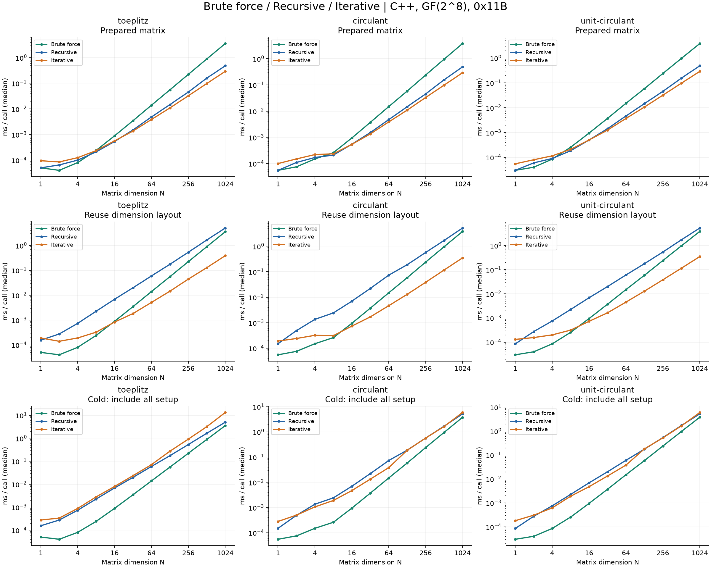
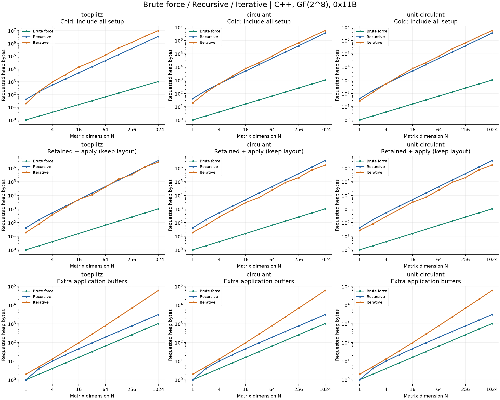

# C++ Brute force／Recursive／Iterative 三版本比較

本機驗證日期：2026-10-09（Asia/Taipei）。目前 iterative 是論文通式與共用計算概念的等價排程重建，並非 Algorithm 1–4 的逐行翻譯；見 [論文與程式逐項對照](../../docs/paper-correspondence.zh-TW.md)。不宣稱已證明時間或空間最優。

Brute force 是直接雙層迴圈逐項計算（原始 CSV 的 baseline），直接讀取結構化矩陣輸入；三版共用相同 scalar kernel，未另加乘法查表或手寫 SIMD。同一尺寸內使用相同矩陣、向量與 GF(2⁸) scalar kernel（0x11B），先核對正確性再計時。每項先暖機，隨機排列量測順序；表格與曲線是每輪平均時間的中位數，原始樣本與四分位數另存 CSV。這是本機固定輸入重複執行的結果，不代表所有硬體或串流工作負載。計時未啟用運算計數器或記憶體 profiler。

平台：`Windows-11-10.0.26200-SP0`；CPU：`AMD64 Family 25 Model 117 Stepping 2, AuthenticAMD`。編譯參數：`-std=c++17 -O3 -Wall -Wextra -Wpedantic`。完整編譯器資訊、執行參數與來源 SHA-256 見 [metadata.json](metadata.json)。

## 最大尺寸的結果

| N=1024 | 比較情境 | Brute force | Recursive | Iterative |
|---|---|---|---|---|
| toeplitz | 矩陣已準備：ms／次 | 3.550695 | 0.480230 | 0.292210 |
| toeplitz | 只共用尺寸排程：ms／次 | 3.550695 | 5.012625 | 0.386680 |
| toeplitz | 首次完整計算：ms／次 | 3.550695 | 5.012625 | 13.277285 |
| circulant | 矩陣已準備：ms／次 | 3.790130 | 0.486645 | 0.290945 |
| circulant | 只共用尺寸排程：ms／次 | 3.790130 | 5.186385 | 0.349350 |
| circulant | 首次完整計算：ms／次 | 3.790130 | 5.186385 | 5.896210 |
| unit-circulant | 矩陣已準備：ms／次 | 3.811650 | 0.485015 | 0.288720 |
| unit-circulant | 只共用尺寸排程：ms／次 | 3.811650 | 5.265200 | 0.347220 |
| unit-circulant | 首次完整計算：ms／次 | 3.811650 | 5.265200 | 6.008245 |

同一個 brute force 數值出現在三種情境，因為它沒有獨立 layout 或矩陣 plan。這不是三次不同的量測。時間沿用既有同批三版本 benchmark 原始樣本；記憶體已補測 brute force 與首次完整計算的峰值。

- toeplitz：矩陣已準備時，iterative 相對 brute force 的加速比為 12.15，相對 recursive 為 1.64；保留 layout 時，recursive／iterative 總 payload 比為 1.31。首次成本另列。
- circulant：矩陣已準備時，iterative 相對 brute force 的加速比為 13.03，相對 recursive 為 1.67；保留 layout 時，recursive／iterative 總 payload 比為 2.15。首次成本另列。
- unit-circulant：矩陣已準備時，iterative 相對 brute force 的加速比為 13.20，相對 recursive 為 1.68；保留 layout 時，recursive／iterative 總 payload 比為 2.14。首次成本另列。

## 各階段明細

| N=1024，毫秒 | toeplitz | circulant | unit-circulant |
|---|---|---|---|
| baseline | 3.550695 | 3.790130 | 3.811650 |
| recursive_prepare | 4.618600 | 4.720880 | 4.780550 |
| recursive_apply | 0.480230 | 0.486645 | 0.485015 |
| recursive_end | 5.012625 | 5.186385 | 5.265200 |
| iterative_layout | 12.650590 | 5.565150 | 5.589320 |
| iterative_prepare | 0.095990 | 0.055800 | 0.056985 |
| iterative_apply | 0.292210 | 0.290945 | 0.288720 |
| iterative_hot_end | 0.386680 | 0.349350 | 0.347220 |
| iterative_cold_end | 13.277285 | 5.896210 | 6.008245 |

recursive_prepare 包含建立與釋放遞迴樹；iterative_layout 包含建立與釋放尺寸排程；iterative_prepare 使用現成 layout，包含建立與釋放矩陣 plan。apply 使用現成 plan，包含工作緩衝區、輸出配置及 checksum。recursive_end 包含矩陣預計算與一次 apply；iterative_hot_end 共用 layout，但每次重建矩陣 plan；iterative_cold_end 每次重新建立 layout、plan，再 apply，並計入釋放成本。各階段中位數不可直接相加當作實測端到端時間。

## 記憶體

| N=1024 | 比較情境 | Brute force | Recursive | Iterative |
|---|---|---|---|---|
| toeplitz | 首次完整計算峰值：bytes | 1,024 | 3,551,075 | 9,920,288 |
| toeplitz | 已準備，保留 layout 的總量：bytes | 1,024 | 3,545,990 | 2,696,858 |
| toeplitz | 已準備，釋放 layout 的總量：bytes | 1,024 | 3,545,990 | 119,122 |
| toeplitz | 每次額外空間，含輸出：bytes | 1,024 | 3,070 | 60,073 |
| circulant | 首次完整計算峰值：bytes | 1,024 | 3,551,075 | 5,431,616 |
| circulant | 已準備，保留 layout 的總量：bytes | 1,024 | 3,545,990 | 1,648,282 |
| circulant | 已準備，釋放 layout 的總量：bytes | 1,024 | 3,545,990 | 119,122 |
| circulant | 每次額外空間，含輸出：bytes | 1,024 | 3,070 | 60,073 |
| unit-circulant | 首次完整計算峰值：bytes | 1,024 | 3,551,075 | 5,431,616 |
| unit-circulant | 已準備，保留 layout 的總量：bytes | 1,024 | 3,545,990 | 1,656,474 |
| unit-circulant | 已準備，釋放 layout 的總量：bytes | 1,024 | 3,545,990 | 127,314 |
| unit-circulant | 每次額外空間，含輸出：bytes | 1,024 | 3,070 | 60,073 |

### 保存資料與準備階段明細

| N=1024，bytes | toeplitz | circulant | unit-circulant |
|---|---|---|---|
| Brute force：運算峰值（含輸出） | 1,024 | 1,024 | 1,024 |
| 遞迴：首次完整計算峰值 | 3,551,075 | 3,551,075 | 3,551,075 |
| 迭代：首次完整計算峰值 | 9,920,288 | 5,431,616 | 5,431,616 |
| 遞迴：保存的 plan | 3,542,920 | 3,542,920 | 3,542,920 |
| 迭代：保存的 plan | 59,049 | 59,049 | 67,241 |
| 迭代：可共用的 layout | 2,577,736 | 1,529,160 | 1,529,160 |
| 迭代：建立 layout 峰值 | 9,920,288 | 5,431,616 | 5,431,616 |
| 遞迴：每次額外空間（含輸出） | 3,070 | 3,070 | 3,070 |
| 迭代：每次額外空間（含輸出） | 60,073 | 60,073 | 60,073 |
| 遞迴：plan＋運算空間 | 3,545,990 | 3,545,990 | 3,545,990 |
| 迭代：plan＋運算空間（已釋放 layout） | 119,122 | 119,122 | 127,314 |
| 迭代：layout＋plan＋運算空間 | 2,696,858 | 1,648,282 | 1,656,474 |

記憶體由獨立程式攔截 new/delete，記錄 requested heap payload；已核對 vector capacity 與節點大小公式。排除輸入、stack、容器物件本體、allocator metadata、作業系統 RSS；不是整個程序的記憶體。額外空間包括輸出；總量以仍需保留的資料加上該次 apply 峰值計算。layout 可共用，也可在 plan 準備完成後釋放。layout build 峰值包含暫存 hash table；沒有把預計算成本隱藏在免費快取中。

Brute force 每次需要 N² 次乘法、N(N−1) 次 XOR；遞迴與迭代都有 3ⁿ−U 次乘法和 3(3ⁿ−2ⁿ) 次向量端 XOR，其中 U=N 只適用 unit-sum circulant，其他情況 U=0。此迭代版每次需要 3ⁿ+N bytes，遞迴版為 3N−2 bytes，brute force 為 N bytes；這些數字都包含輸出。迭代版較小的 plan 和建立排程的峰值需分別評估。

## 圖與原始資料

- [可獨立開啟的報告](report.html)
- [時間中位數與四分位數](summary.csv)、[記憶體各階段](memory.csv)
- 原始時間樣本：[toeplitz](toeplitz-raw.csv), [circulant](circulant-raw.csv), [unit-circulant](unit-circulant-raw.csv)
- [API、演算法與重現指令](../../docs/iterative.md)

每張子圖都包含三個版本，顏色固定：綠色 brute force、藍色 recursive、橘色 iterative。時間圖三列依序為矩陣已準備、只共用尺寸排程、首次完整計算；記憶體圖依序為首次峰值、已準備且保留排程的總量、每次額外空間。所有圖的 N 與數值軸採對數刻度。
