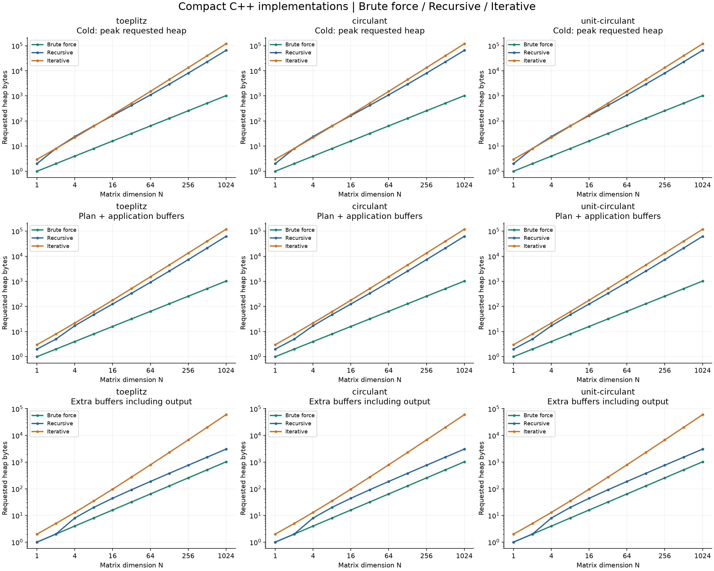

# 經實作改善後的三版本比較

本機驗證：2026-10-09（Asia/Taipei）。原本的公式與結果通過驗證，但原版的指標樹、hash 排程和內圈索引成本並非唯一實作方式。本版改善這些成本；不宣稱已證明全域最優。

Recursive 改存連續葉係數，預計算使用遞迴填入預配置陣列，運算仍遞迴呼叫 F/G/H；2×2 底層合併計算。Iterative 用逐層迴圈直接準備係數，避免建立 hash layout，再依已推導的 PARAMS 三子規則執行。一般乘積迴圈移除逐元素 identity 判斷；unit 位置由三進位規則產生，內圈使用預先取得的陣列指標。Brute force 在 circulant 以 bitmask 取代餘數，Toeplitz 將內圈切成兩段。三者都提供配置版與重用緩衝區版。

此次兩種預計算都使用 3·3ⁿ−4N+1 次係數 XOR，沒有做原 hash layout 的係數子式去重。這是用較規律的數值計算取代大量結構建置的選擇；原版較少的係數 XOR 並未被當作錯誤。向量端一般情況仍為 3ⁿ 次乘法、3(3ⁿ−N) 次 XOR，unit-sum circulant 為 3ⁿ−N 次乘法。

## 時間

| N=1024 | 情境 | Brute force | Recursive | Iterative |
|---|---|---|---|---|
| toeplitz | 已準備，每次配置緩衝區（ms） | 0.212669 | 0.273791 | 0.107400 |
| toeplitz | 已準備，重用緩衝區（ms） | 0.212806 | 0.273572 | 0.107209 |
| toeplitz | 首次：準備＋運算（ms） | 0.212669 | 0.431119 | 0.213719 |
| circulant | 已準備，每次配置緩衝區（ms） | 0.578462 | 0.277481 | 0.108387 |
| circulant | 已準備，重用緩衝區（ms） | 0.579512 | 0.273991 | 0.107153 |
| circulant | 首次：準備＋運算（ms） | 0.578462 | 0.436581 | 0.212188 |
| unit-circulant | 已準備，每次配置緩衝區（ms） | 0.579722 | 0.270794 | 0.115609 |
| unit-circulant | 已準備，重用緩衝區（ms） | 0.579809 | 0.270881 | 0.115169 |
| unit-circulant | 首次：準備＋運算（ms） | 0.579722 | 0.428822 | 0.219869 |

三版共用 GF(2⁸) 的 0x11B 八步 scalar kernel、編譯器及 -O3 設定；沒有另加乘法查表或手寫 SIMD，編譯器可自行向量化。每個尺寸使用相同矩陣與 16 個輪替向量，先驗證所有輸出與係數順序，再暖機、打散測量順序。表格為每輪平均時間的中位數，原始樣本與四分位數另存。計時不啟用 counts 或 heap profiler。

已準備的配置版包含輸出／work 配置、運算、checksum 及釋放；重用版包含運算、檢查與 checksum，但緩衝區在計時前配置。首次包含該方法的係數準備、一次運算與釋放。新版不需要大型尺寸 layout，所以沒有免費隱藏的 hash 預計算。原版也在同次 benchmark、相同資料上重新測量；歷史報告仍保留，不能直接混用不同工作負載的舊數字。

## 記憶體

| N=1024 | 情境 | Brute force | Recursive | Iterative |
|---|---|---|---|---|
| toeplitz | 首次 heap 峰值（bytes） | 1,024 | 65,168 | 119,122 |
| toeplitz | 已準備，保存資料＋運算空間（bytes） | 1,024 | 62,117 | 119,122 |
| toeplitz | 每次額外緩衝區，含輸出（bytes） | 1,024 | 3,068 | 60,073 |
| toeplitz | 重用緩衝區後，每次 new 次數 | 0 | 0 | 0 |
| circulant | 首次 heap 峰值（bytes） | 1,024 | 65,168 | 119,122 |
| circulant | 已準備，保存資料＋運算空間（bytes） | 1,024 | 62,117 | 119,122 |
| circulant | 每次額外緩衝區，含輸出（bytes） | 1,024 | 3,068 | 60,073 |
| circulant | 重用緩衝區後，每次 new 次數 | 0 | 0 | 0 |
| unit-circulant | 首次 heap 峰值（bytes） | 1,024 | 65,168 | 119,122 |
| unit-circulant | 已準備，保存資料＋運算空間（bytes） | 1,024 | 62,117 | 119,122 |
| unit-circulant | 每次額外緩衝區，含輸出（bytes） | 1,024 | 3,068 | 60,073 |
| unit-circulant | 重用緩衝區後，每次 new 次數 | 0 | 0 | 0 |

記憶體為獨立 new/delete profiler 的 requested heap payload，排除輸入、stack、容器本體、allocator metadata 與 RSS。兩種 plan 都只保存 3ⁿ 個係數 bytes；unit 模式不保存額外葉索引表。Recursive 的工作緩衝區是 N≤2 時 0，其他尺寸 2N−4 bytes；iterative 是 3ⁿ bytes，另加 N bytes 輸出。重用模式每次零配置不表示零記憶體，其預配置緩衝區已計入保存資料＋運算空間。遞迴還有未列入 heap 的呼叫堆疊。

## 同一次執行中的原版對照

| N=1024 | 方法 | 原版（ms） | 新版（ms） | 原版／新版時間 |
|---|---|---|---|---|
| toeplitz | Brute force apply | 3.564059 | 0.212669 | 16.76 |
| toeplitz | Recursive apply | 0.466125 | 0.273791 | 1.70 |
| toeplitz | Iterative apply | 0.291903 | 0.107400 | 2.72 |
| toeplitz | Recursive 首次 | 5.058766 | 0.431119 | 11.73 |
| toeplitz | Iterative 首次 | 12.721984 | 0.213719 | 59.53 |
| circulant | Brute force apply | 3.813647 | 0.578462 | 6.59 |
| circulant | Recursive apply | 0.464603 | 0.277481 | 1.67 |
| circulant | Iterative apply | 0.291366 | 0.108387 | 2.69 |
| circulant | Recursive 首次 | 5.136566 | 0.436581 | 11.77 |
| circulant | Iterative 首次 | 5.900144 | 0.212188 | 27.81 |
| unit-circulant | Brute force apply | 3.788125 | 0.579722 | 6.53 |
| unit-circulant | Recursive apply | 0.465366 | 0.270794 | 1.72 |
| unit-circulant | Iterative apply | 0.288816 | 0.115609 | 2.50 |
| unit-circulant | Recursive 首次 | 5.049762 | 0.428822 | 11.78 |
| unit-circulant | Iterative 首次 | 5.871941 | 0.219869 | 26.71 |

原版／新版時間比大於 1 才表示新版較快。這些比值只代表本機、這些尺寸與本次工作負載；小尺寸計時容易受到配置及計時開銷影響。

## 圖表與重現

平台：`Windows-11-10.0.26200-SP0`；CPU：`AMD64 Family 25 Model 117 Stepping 2, AuthenticAMD`。

- [完整 HTML 報告](report.html)、[各階段中位數與四分位數](summary.csv)、[記憶體測量](memory.csv)
- [執行參數、來源 SHA-256 與編譯器資訊](metadata.json)
- [程式/API 與實作取捨](../../docs/packed.md)
- [歷史三版本報告](../iterative/README.md)、[PARAMS 推導](../../docs/params-derivation.zh-TW.md)
