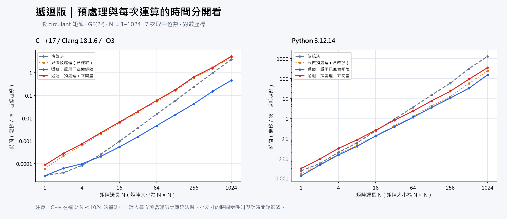
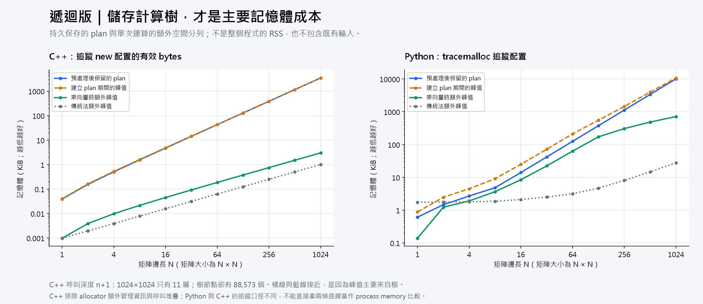

# 遞迴版時間與記憶體分析

量測日期：2026-10-07（Asia/Taipei）。本報告僅分析目前重建的遞迴版，沒有混入迭代版，也不代表原論文原始程式的效能。

## 主要結論

- 時間的理論改善來自三個半尺寸子問題：傳統法 Θ(N²)，預處理後的遞迴運算 Θ(N^log₂3)，約 Θ(N^1.585)。
- N 加倍，理論上傳統乘法量約 4 倍，遞迴乘法量 3 倍；實際時間還包含函式呼叫、索引、配置、快取等成本。
- 目前版本持久儲存完整三叉樹：節點數 (3^(n+1)−1)/2，因此 plan 記憶體為 Θ(N^1.585)。這是實作選擇，不是所有遞迴演算法都必須使用的空間。
- C++ 已使用共用 scratch：單次乘向量為 N-byte 輸出 + (2N−2)-byte 暫存；額外 heap 合計 3N−2 bytes，另有 Θ(log N) 的呼叫堆疊。
- 因此只消除遞迴呼叫，不會自動移除儲存計算樹的成本；迭代版需要同時改變資料表示與共用中間變數的方式。

## 時間圖

## 記憶體圖

## 精確運算與儲存公式

| 項目 | 目前遞迴版，N=2ⁿ | N 加倍時 |
|---|---|---|
| 一般乘法次數 | 3ⁿ | 3 倍 |
| 列 XOR 為 1 的 circulant 乘法次數 | 3ⁿ−2ⁿ | 趨近 3 倍 |
| 每個向量的加法次數 | 3(3ⁿ−2ⁿ) | 趨近 3 倍 |
| 係數預處理加法次數 | 3·3ⁿ−4·2ⁿ+1 | 趨近 3 倍 |
| 持久樹節點數 | (3^(n+1)−1)/2 | 趨近 3 倍 |
| C++ 單次額外 heap | 3N−2 bytes | 趨近 2 倍 |
| 最深呼叫層數（含 scalar 葉節點） | n+1 | 多 1 層 |

列 XOR 為 1 的快捷路徑只減少 N 次 scalar multiplication；目前樹的結構與節點數沒有改變。本次曲線採用一般 circulant，沒有開啟這個快捷路徑。

## 實際時間

| 語言 | N | 傳統 ms | 重用 plan ms | 每次重建 ms | 重用加速比 | 每次重建加速比 |
|---|---:|---:|---:|---:|---:|---:|
| C++ | 16 | 0.00095 | 0.00054 | 0.00672 | 1.77× | 0.14× |
| C++ | 64 | 0.01496 | 0.00467 | 0.05989 | 3.20× | 0.25× |
| C++ | 128 | 0.05900 | 0.01407 | 0.17689 | 4.19× | 0.33× |
| C++ | 256 | 0.24039 | 0.04264 | 0.65789 | 5.64× | 0.37× |
| C++ | 512 | 0.96725 | 0.15128 | 1.68060 | 6.39× | 0.58× |
| C++ | 1024 | 3.78859 | 0.45712 | 5.23738 | 8.29× | 0.72× |
| Python | 16 | 0.23470 | 0.13090 | 0.25280 | 1.79× | 0.93× |
| Python | 64 | 3.57590 | 1.11780 | 2.30950 | 3.20× | 1.55× |
| Python | 128 | 14.92250 | 3.52020 | 7.59870 | 4.24× | 1.96× |
| Python | 256 | 57.65180 | 10.41920 | 22.82910 | 5.53× | 2.53× |
| Python | 512 | 312.15510 | 32.26020 | 91.98460 | 9.68× | 3.39× |
| Python | 1024 | 1296.59660 | 152.02280 | 349.26130 | 8.53× | 3.71× |

加速比 = 傳統時間 / 遞迴時間；小於 1 表示遞迴版本較慢。這次 C++ 在 N=1024 的 prepared apply 加速約 8.29×，但每次重建只有 0.72×。不要把 prepared-only 結果寫成所有使用情境的加速。

## 預處理要重用幾次才划算？

簡化估算：T_dynamic(K) ≈ P + K·D，T_baseline(K) ≈ K·B。當 B>D 時，嚴格較快的最小整數 K = floor(P/(B−D))+1。P 是含釋放的獨立預處理時間；這是根據分開量測所作的攤提估算，不是 batch benchmark，也未建模 CPU cache/allocator 隨 K 的變化。

| 語言 | N=128 | N=256 | N=512 | N=1024 |
|---|---:|---:|---:|---:|
| C++ | 4 | 3 | 2 | 2 |
| Python | 1 | 1 | 1 | 1 |

## 實際記憶體

| N | C++ plan MiB | C++ 乘向量額外 bytes | Python plan MiB | Python 乘向量額外 KiB |
|---:|---:|---:|---:|---:|
| 16 | 0.005 | 46 | 0.014 | 8.44 |
| 64 | 0.042 | 190 | 0.123 | 63.18 |
| 128 | 0.125 | 382 | 0.367 | 172.12 |
| 256 | 0.375 | 766 | 1.101 | 306.88 |
| 512 | 1.126 | 1534 | 3.304 | 484.02 |
| 1024 | 3.379 | 3070 | 9.911 | 716.56 |

本機 C++ sizeof(Node)=40 bytes。N=1024 時，88,573 個節點即 3,542,920 bytes，約 3.38 MiB；3,070 bytes 是額外 scratch 與輸出，不能誤當作整個演算法的記憶體使用量。傳統 baseline 直接讀取 circulant 第一欄，不建立 N×N dense matrix，所以 baseline 也只需線性空間。

## 測量口徑與限制

- OS：Windows-11-10.0.26200-SP0；CPU 識別：AMD64 Family 25 Model 117 Stepping 2, AuthenticAMD。
- Python：3.12.14 (main, Aug 25 2026, 14:01:42) [MSC v.1944 64 bit (AMD64)]；C++：Clang 18.1.6 / Zig 0.13.0，`-std=c++17 -O3 -Wall -Wextra -Wpedantic`。
- 時間：每尺寸同一矩陣／向量，先 warmup、隨機交換測量順序，7 次中位數；Python 每次 1 iteration，C++ 每次 100 iterations。兩個語言使用各自的 PRNG；比較的是相同類型與尺寸，沒有宣稱輸入值逐一相同。
- 正確性：每尺寸先比對傳統結果；記憶體測量也另行比對。時間與記憶體追蹤分開執行，避免 profiler 扭曲計時。
- C++ heap：獨立 executable 攔截 new/delete；計 requested bytes，排除 allocator headers、碎片、既有 input、stack、process RSS。追蹤結果另與 node_count × sizeof(Node)、3N−2 公式核對。
- Python：tracemalloc，量測前清除 GC，分階段重新開始追蹤；retained 在清除暫存 free-list 後讀取。排除既有 inputs 與 apply 前已存在的 plan；包含追蹤到的 Python 物件配置，不能等同 C++ 的有效 payload bytes 或 RSS。
- 單次總成本要同時考慮 retained plan + apply extra peak，以及建立 plan 的峰值；不要把不同時間階段的峰值直接全部相加。
- 樹的建立與釋放、遞迴 stack 的常數成本、Python 容器表示，都是此重建版本的特性。尚未逐行還原原論文 PARAMS 版本，亦未證明空間／時間最優。

## 後續迭代版的比較基準

後續應固定相同輸入與 scalar kernel，分開量測尺寸相關 schedule 建立、矩陣係數 precompute、每個新向量的中間值、單次和多次使用；同時報告共享 schedule、plan、workspace 的記憶體。不能只把 recursion 改成 for-loop，再將差異全部歸因於迭代。

## 檔案与重現

- `python-time.json` 保留全部時間樣本；CSV 為中位數摘要。C++ CSV 目前只保留中位數，compiler metadata 另存。
- `python-memory.json`、`cpp-memory.csv` 為記憶體原始測量；PNG 與 SVG 由 `tools/plot_recursive_analysis.py` 產出。
- 核心程式與量測程式 SHA-256：

  - `dynamic_matrix/core.py`：`9c6534b33e7b64ecbe60448d15294ee9221fc5424371b4e61046bdf8cc0022d3`
  - `cpp/dynamic_matrix.hpp`：`84744f3b392ab1305293e7e9b2f847466156b0b5950290586281384e6f7daab8`
  - `dynamic_matrix/__main__.py`：`7b1a0c09e9bf7987808fdd7063b5ff0ff52993499b7e9cdc053969521b3b8faf`
  - `cpp/benchmark.cpp`：`5cb0489dcaa382184c24251a1312a3c6f7210afb39a6ea976aaf9e3f2b6d115d`
  - `tools/recursive_memory.py`：`e927f0cc2f7de6d704613551013d66c31a91ad469feb42cdce1a9697ccf02ca2`
  - `tools/recursive_memory.cpp`：`0ccdfe16c06a5e27dea9e32b83e2b3e7bb48000eed59c151b33760cc5f63a60c`
